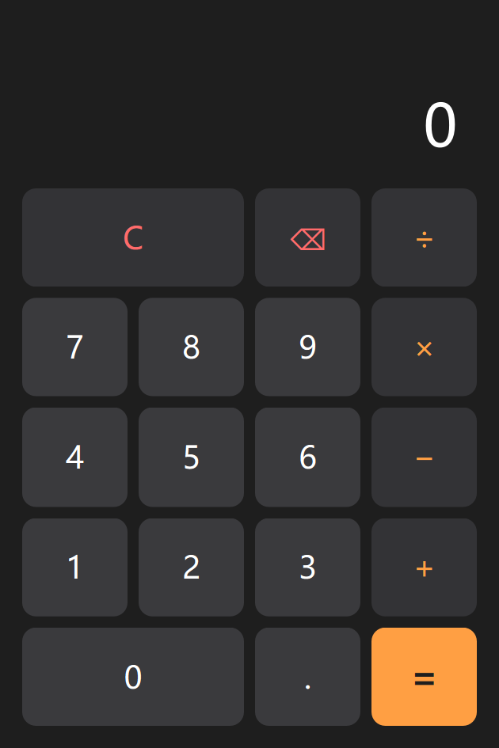

# QtTest —— 实验1：带键盘事件的计算器

使用 Qt 6 Widgets 实现的两操作数计算器，支持鼠标按键和键盘输入，两种输入方式复用同一套状态机。



## 功能

- 加、减、乘、除四则运算
- 小数输入（同一操作数只允许一个小数点）
- 退格（⌫）和清除（C）
- 键盘输入：数字键（含小键盘）、`+` `-` `*` `/`、`Enter`/`=`、`Backspace`、`Esc`/`Delete`
- 连续运算、结果后继续输入、连续操作符、除零提示
- QSS 深色主题

## 目录结构

```
Calculator/
├── CMakeLists.txt
├── main.cpp              程序入口
├── calculator.h/.cpp     计算器窗口与输入状态机
├── calculator.ui         Qt Designer 界面文件
├── style.qss             界面样式表
├── resources.qrc         样式资源
├── tests/tst_calculator.cpp   QtTest 单元测试
└── tools/capture_screenshots.cpp  报告截图生成工具
docs/screenshots/         实验报告截图
```

## 构建与运行

用 Qt Creator 打开 `Calculator/CMakeLists.txt`，选择 Qt 6.9.2 MinGW 套件构建运行。

命令行方式：

```bash
cmake -S Calculator -B build -G Ninja \
      -DCMAKE_PREFIX_PATH=D:/Qt/6.9.2/mingw_64 \
      -DCMAKE_CXX_COMPILER=D:/Qt/Tools/mingw1310_64/bin/g++.exe
cmake --build build
./build/Calculator.exe
```

## 测试

```bash
cd build
ctest --output-on-failure
```

## 键盘映射

| 按键 | 功能 |
| --- | --- |
| `0`–`9`（主键盘/小键盘） | 输入数字 |
| `.` / `,` | 小数点 |
| `+` `-` `*` `/` | 运算符 |
| `Enter` / `=` | 计算结果 |
| `Backspace` | 退格 |
| `Esc` / `Delete` | 清除 |

鼠标按键与键盘按键都会转换为统一的按键码，由 `Calculator::handleKey()` 处理，
因此两种输入方式的行为完全一致。
